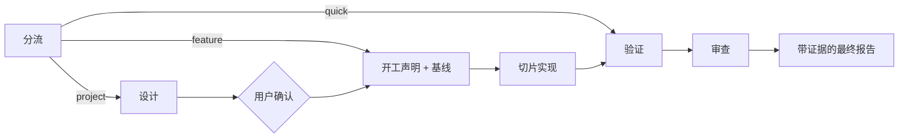

# dev-flow

面向 Claude Code 和 Codex 的轻量软件工程工作流插件。

它适合新功能、新项目、跨文件修改、复杂缺陷和性能任务。小型低风险修改仍由 agent 直接完成，不会因为安装插件就强制建立完整流程。

## 安装

### Claude Code 本地试用

```powershell
claude --plugin-dir .\dev-flow
```

### Claude Code 从 GitHub marketplace 安装

```powershell
claude plugin marketplace add ARPHS/dev-flow
claude plugin install dev-flow@dev-flow
```

### Codex CLI

```powershell
codex plugin marketplace add ARPHS/dev-flow
codex plugin add dev-flow@dev-flow
```

安装后启动新会话。技能统一使用 `df-` 前缀，主流程也会根据任务意图和风险按需触发。

## 入口

| 技能 | 用途 | 自动触发 |
|---|---|---|
| `df-flow` | 推进新功能、新项目、复杂缺陷直到有证据的完成 | 是 |
| `df-plan` | 规划、设计和方案变更 | 否 |
| `df-review` | 审查方案、代码、任务和交付 | 否 |
| `df-debug` | 处理根因不明的缺陷或性能问题 | 是 |
| `df-verify` | 运行适用检查并整理证据 | 是 |

Claude Code 中可使用短命令 `/df-plan`，插件完整命令为 `/dev-flow:df-plan`。Codex 使用 `$df-plan` 等名称。

## 工作方式



- **开工声明**：`feature` 和 `project` 先输出分级、验收条件、项目命令、基线和验证计划，用户可以随时纠正。
- **基线**：修改代码前先运行现有测试和构建，以区分本次引入的失败和原本就有的失败。
- **project 停顿**：设计确认前不写实现代码。
- **证据绑定版本**：`df-verify` 用指纹记录证据对应的代码版本，代码改动后旧证据自动失效。
- **独立审查**：`project` 级别由 `df-reviewer` 子代理在新上下文中审查（Codex 下降级为 `$df-review`）。

## 状态目录

长任务在目标项目创建 `.flow/`（`project.md`、`task.md`、`progress.md`、`decisions.md`），用于跨会话恢复。首次创建时会把它加入 `.git/info/exclude`，不会出现在 `git status` 中，也不会修改项目的 `.gitignore`。

## 可选：完成门禁 hook

插件默认不安装任何 hook。如果希望机械地阻止"`progress.md` 标记完成，但证据与当前代码不一致"的情况，可以在项目或用户的 `.claude/settings.json` 中加入：

```json
{
  "hooks": {
    "Stop": [
      {
        "hooks": [
          { "type": "command", "command": "python \"<插件路径>/skills/df-verify/scripts/check_evidence.py\"" }
        ]
      }
    ]
  }
}
```

该脚本只在 `.flow/progress.md` 存在且 `状态：done` 时生效，每次停止最多拦截一次，其他情况直接放行。

## 设计取舍

工作流不使用启动 hook，不要求项目安装 `.claude/` 配置，也不把所有任务都强制升级到重流程。完成声明必须包含实际验证证据。详细设计见 [`docs/design.md`](docs/design.md)。

## 开发和校验

```powershell
python -X utf8 -m unittest discover -s tests   # 结构、脚本、评分器自检（免费）
claude plugin validate . --strict
python -X utf8 evals/run.py                    # 真实 agent 行为评测（会产生费用）
```

评测说明见 [`evals/README.md`](evals/README.md)。

## 许可证

MIT
