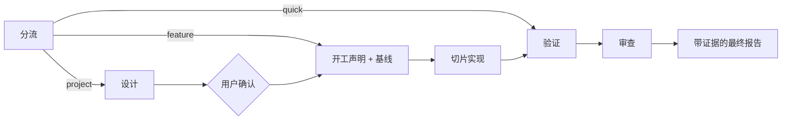

# dev-flow

面向 Claude Code 和 Codex 的轻量软件工程工作流插件。

它适合新功能、新项目、跨文件修改、复杂缺陷和性能任务。小型低风险修改仍由 agent 直接完成，不会因为安装插件就强制建立完整流程。

## 环境要求

| 依赖 | 版本 | 用途 |
|---|---|---|
| Claude Code 或 Codex CLI | Claude Code 2.1.326、Codex CLI 0.169.1 上验证过 | 运行插件。Codex 需要支持 `spawn_agent` 的版本（多代理 v2，默认开启），否则独立审查退化为"非独立审查" |
| Git | 2.31 及以上 | 基线、diff 审查和证据快照 |
| Python | 3.8 及以上，命令名 `python` 或 `python3` | 运行 `evidence.py`，只用标准库 |

缺少 Python 或 git 版本过低时工作流仍可使用，只是证据改为手工记录，并在报告中注明。目标项目最好是 Git 仓库；不是 Git 仓库时没有快照，`.dev-flow/` 的证据记录也不可用。

开发本插件（运行 `tests/`、`evals/`）另需 Python 3.8 及以上；`evals/run.py` 还需要已登录的 Claude Code CLI，会产生费用。

### Codex 在 Windows 上的建议配置

以下设置不是插件必需的，但能明显减少 Codex 在 Windows 上的无效往返（编码出错重试、沙箱权限错误后反复绕行）。在 `~/.codex/config.toml` 中加入，放在 `[features]` 等表之前：

```toml
[shell_environment_policy]
# 只作用于 Codex 执行的命令：Python 默认 UTF-8；git 不检查仓库归属（elevated 沙箱用户与仓库所有者不同）
set = { PYTHONUTF8 = "1", GIT_CONFIG_COUNT = "1", GIT_CONFIG_KEY_0 = "safe.directory", GIT_CONFIG_VALUE_0 = "*" }

[windows]
sandbox = "elevated"         # 使用独立的低权限沙箱用户，而不是从当前用户派生的受限令牌
```

- **`PYTHONUTF8`**：中文 Windows 默认代码页是 GBK，Python 打印中文到管道、`open()` 不指定编码时会出错或乱码，模型随后会反复换写法重试。
- **`GIT_CONFIG_*`（`safe.directory = *`）**：`elevated` 沙箱中的命令以沙箱用户运行，而仓库属于你的账户，git 会报 `detected dubious ownership` 并拒绝执行，`evidence.py` 的快照也会失败。这三个变量等同于 `git -c safe.directory=*`，只对 Codex 执行的命令生效，不修改任何 gitconfig。代价是这些命令不再检查仓库归属（该检查用于防止在他人仓库中触发恶意 git 配置）；只在可信的工作区中使用 Codex 时影响很小。不用 `elevated` 沙箱时不需要。
- **`elevated` 沙箱**：需要管理员一次性初始化（创建 `CodexSandboxOffline`、`CodexSandboxOnline` 用户、防火墙规则和目录权限）。`codex exec` 等非交互运行不会弹出授权窗口，请在**以管理员身份运行**的 PowerShell 中执行：

  ```powershell
  codex sandbox setup --elevated --current-user
  # 使用其他 CODEX_HOME（例如评测专用目录）时，对该目录再执行一次
  codex sandbox setup --elevated --user "$env:COMPUTERNAME\$env:USERNAME" --codex-home "<CODEX_HOME 路径>"
  ```

  初始化后第一次在沙箱中运行命令时，Codex 会在后台为沙箱用户授予系统目录的读取权限，可能持续数分钟，期间命令看起来没有响应，属于正常现象，只发生一次。支持 MXC 的设备（Windows 11 24H2 build 26100.9278 及以上）可以改用无需管理员的 `[features] prefer_mxc = true`，用 `codex -c windows.sandbox=mxc sandbox --permission-profile :workspace -- cmd.exe /d /c echo MXC_OK` 检查是否可用。
  `elevated` 下 Python 3.12.4 及以上的 `tempfile` 目录可以正常读写（Codex CLI 0.169.1、Python 3.12.12 实测）。
- **无法使用管理员权限时**保留 `sandbox = "unelevated"`。此模式下 Python 3.12.4 及以上用 `tempfile` 创建的目录在沙箱中无法访问，相关测试会报 `PermissionError`；`df-verify` 会把它当作环境阻碍，列入"未运行的检查"并改用真实入口验证，不会为此改写项目测试。
- 全局使用 `sandbox_mode = "danger-full-access"` 时命令不经过沙箱，`[windows]` 设置不起作用；`PYTHONUTF8` 仍然有效。

## 安装

### Claude Code 本地试用

```powershell
claude --plugin-dir .\dev-flow\plugins\dev-flow
```

### Claude Code 从 GitHub marketplace 安装

```powershell
claude plugin marketplace add ARPHS/dev-flow
claude plugin install dev-flow@dev-flow
```

### Codex CLI

```powershell
codex plugin marketplace add ARPHS/dev-flow
codex plugin add dev-flow@dev-flow
```

安装后启动新会话。技能统一使用 `df-` 前缀，主流程也会根据任务意图和风险按需触发。

## 入口

| 技能 | 用途 | 自动触发 |
|---|---|---|
| `df-flow` | 推进新功能、新项目、复杂缺陷直到有证据的完成 | 是 |
| `df-plan` | 规划、设计和方案变更 | 否 |
| `df-review` | 审查方案、代码、任务和交付 | 否 |
| `df-debug` | 处理根因不明的缺陷或性能问题 | 是 |
| `df-verify` | 运行适用检查并整理证据 | 是 |

Claude Code 中可使用短命令 `/df-plan`，插件完整命令为 `/dev-flow:df-plan`。Codex 使用 `$df-plan` 等名称。

## 工作方式



- **开工声明**：`feature` 和 `project` 先输出分级、验收条件、项目命令、基线和验证计划，用户可以随时纠正。
- **基线**：修改代码前先取得现有测试和构建的结果，以区分本次引入的失败和原本就有的失败。代码未变时复用上次全量验证，全量很慢时先跑局部。
- **project 停顿**：设计确认前不写实现代码；用户已确认方案或明确说"直接做"时不停。只有破坏兼容、迁移、新安全边界、架构重组等才算 `project`，向后兼容的新增属于 `feature`。
- **证据由程序记录**：`df-verify` 通过配套 CLI `evidence.py` 运行验证命令，退出码由程序记录，并用 git 给当时的工作区拍快照。最终证据表从记录生成，每条记录之后改了哪些文件一目了然，是否需要重跑由技能规则判断。
- **独立审查**：`project` 级别由 `df-reviewer` 在新上下文中审查：Claude Code 中是插件子代理，Codex 中由主控用 `spawn_agent`（不继承对话）按同一份角色定义派发。

## 状态目录

`feature` 和 `project` 任务在目标项目创建 `.dev-flow/`（`project.md`、`task.md`、`progress.md`、`decisions.md`，以及证据工具使用的 `evidence.jsonl` 和 `objects/`），用于证据记录和跨会话恢复。目录内自带一个内容为 `*` 的 `.gitignore`，不会出现在 `git status` 中，也不会修改项目的 `.gitignore` 或 `.git/`。

## 证据 CLI

`plugins/dev-flow/skills/df-verify/scripts/evidence.py` 是插件唯一的脚本，只用 Python 标准库和 git（2.31 及以上），由 `df-verify` 调用：

| 子命令 | 作用 |
|---|---|
| `run -l AC1 -- <程序> <参数...>` | 直接执行程序（不经过 shell），退出码与原命令一致，记录参数、退出码、耗时、输出摘要和工作区快照；超长输出保存成功后打印日志指针和摘要 |
| `report [--json]` | 列出每条命令的最新记录，标注"当前有效"、"之后改动：<文件>"或"无法对比"；`--json` 输出机器可读结构 |
| `fingerprint` | 打印当前工作区的快照 id，内容相同则 id 相同 |
| `diff <开工快照> <候选快照>` | 只读展示两个已保存快照之间的完整改动，包含未跟踪文件，用于隔离同一文件中的开工前改动 |
| `doctor [--json]` | 只读检查 Python、Git 版本、仓库状态和 `.dev-flow/`，不修改任何配置 |

Linux / WSL 环境没有 `python` 命令时使用 `python3`（在 Bash 中使用 Linux 路径），首次使用可先运行 `python3 plugins/dev-flow/skills/df-verify/scripts/evidence.py doctor` 自检。

快照使用临时暂存区和独立的对象目录 `.dev-flow/objects/`：不改动项目的暂存区、分支或 stash，也不往项目的 `.git` 写入任何对象。超过 10MB 的未跟踪文件不纳入快照；`objects/` 超过 200MB 时自动清空，也可以随时手动删除。

## 设计取舍

工作流不使用任何 hook，不要求项目安装 `.claude/` 配置，也不把所有任务都强制升级到重流程。完成声明必须包含实际验证证据。详细设计见 [`docs/design.md`](docs/design.md)。

## 开发和校验

```powershell
python -X utf8 -m unittest discover -s tests   # 结构、脚本、评分器自检（免费）
claude plugin validate . --strict
claude plugin validate plugins/dev-flow --strict
python -X utf8 evals/run.py                    # 真实 agent 行为评测（会产生费用）
```

评测说明见 [`evals/README.md`](evals/README.md)。

## 许可证

MIT
